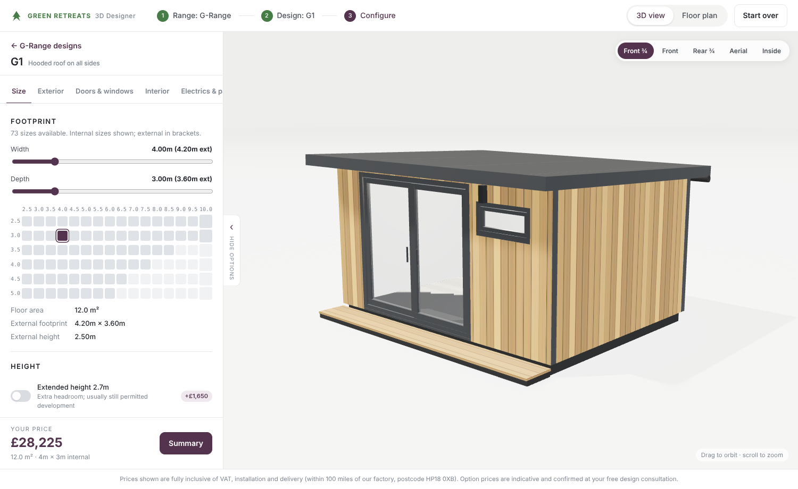
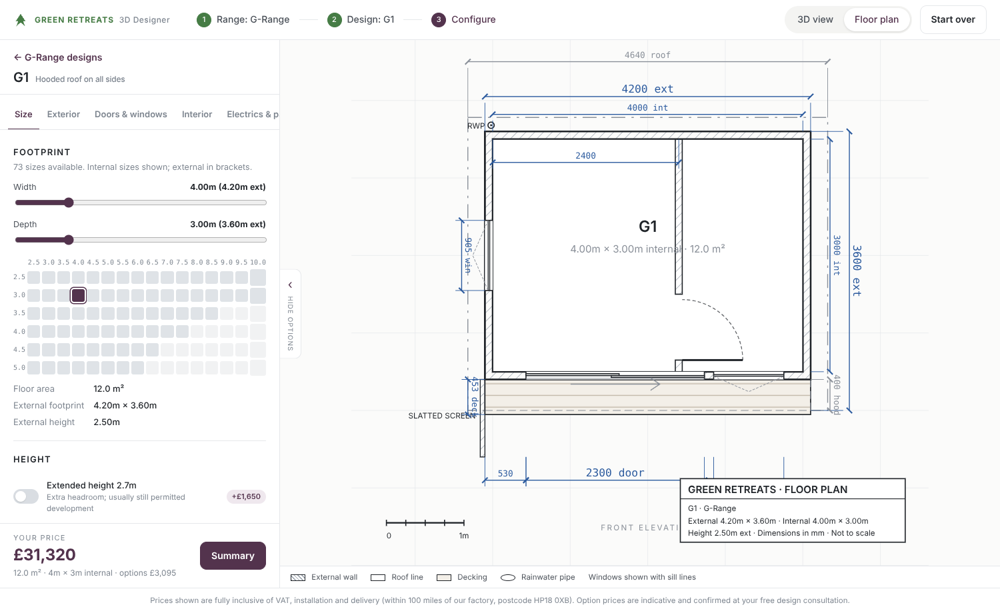
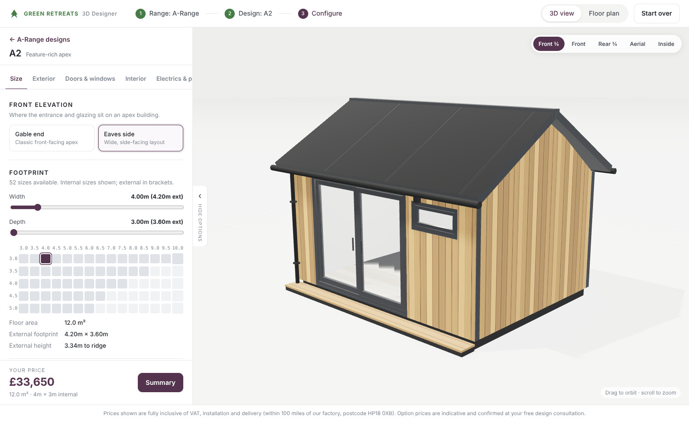
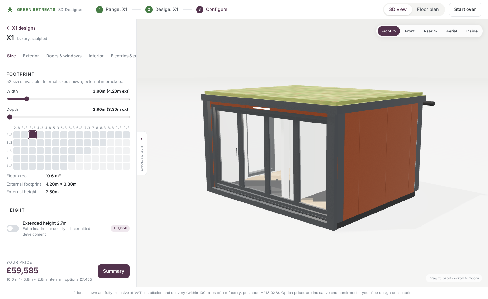

# Green Retreats · 3D Garden Room Designer

A browser-based configurator for the Green Retreats garden room ranges. Customers pick a range, then a design, then configure size, exterior, doors and windows, interior and electrics while watching a photoreal-style 3D model update live. A CAD-style floor plan with full dimensions is one click away and is generated from the same geometry as the 3D view.

## Running it

```bash
npm install
npm run dev        # local dev server
npm run build      # typecheck + production build into dist/
npm run preview    # serve the production build
```

The build is a static site (`dist/`) with no backend, so it can be dropped into the existing WordPress page as an iframe or hosted on any static host.

## What is in the box

| Area | Where | Notes |
| --- | --- | --- |
| Product catalogue | `src/data/catalogue.ts` | Ranges, 16 models, doors, windows, claddings, trims, decking, floors, wall finishes and feature options with availability per model. |
| List prices | `src/data/priceGrids.ts` | Width × depth price matrices scraped from each model page on greenretreats.co.uk (Nov 2026). Internal and external sizes per step. |
| Geometry | `src/model/geometry.ts` | Single source of truth that turns a design into walls, roof, hood, deck, openings, gutters and downpipes. |
| Pricing | `src/model/pricing.ts` | Base price from the grid plus option lines. |
| State & sharing | `src/model/store.ts` | Zustand store; designs are encoded into the URL hash for share links. |
| 3D | `src/three/` | React Three Fiber scene: procedural cladding/decking/floor textures, studio lighting via light formers, PCSS soft shadows, contact shadows, camera presets. |
| Floor plan | `src/plan/PlanView.tsx` | SVG plan with hatched walls, door swings, windows, deck, roof line, partition, side screen, rainwater pipes, dimension strings and a title block. |
| UI | `src/ui/` | Three-step wizard and the categorised configurator panel. |

## Pricing caveats

- **Base building prices are real list prices** taken from the public model pages, including the gable-end and eaves-side tables for the A-Range.
- **Option prices are indicative placeholders.** The public site does not publish option prices; the existing visualiser pulls them from `my.greenretreats.co.uk/configurator/configurator-api/pricing.php`. Every option price lives in `src/data/catalogue.ts` (`price`, `pricePerM`, `perM2`) and is flagged "indicative" in the UI until replaced with the live feed. The structure mirrors the existing API (cladding per linear metre, decking per metre of width, plaster pack offset + per m²).

## Modelling assumptions

- Internal sizes drive the design; external sizes come from the price tables. The difference between external and internal depth is modelled as the front hood/frame depth (G1, G3, G4, G5, B1, B3, B5, X1, The Hide) or roof overhang (apex models).
- Pent roofs fall front-to-back, with the gutter and a downpipe at the rear (two on buildings wider than 6m). Apex roofs have gutters on both eaves. A rainwater pipe is always included.
- The corner window is included on G-Range, A2 and X1 and is dropped automatically when a wide door leaves no room for it.
- Standard heights: 2.5m externally (2.7m extended) for pent buildings; apex pitches of 22° (A1), 30° (A2) and 35° (The Nest).

## Screenshots

| 3D view (G1) | Floor plan (G1) |
| --- | --- |
|  |  |

| A2 eaves-side | X1 with sedum roof |
| --- | --- |
|  |  |
